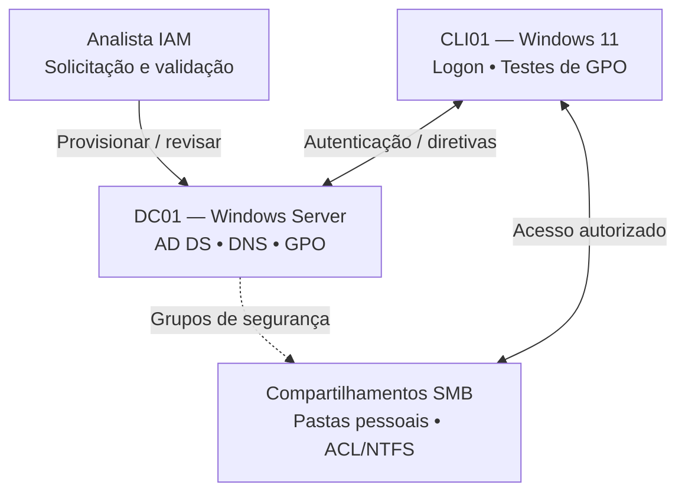

# Enterprise IAM Lab | Active Directory & Windows Server

> Laboratório prático de **Gestão de Identidades e Acessos (IAM)** em ambiente Windows, com foco em **ciclo de vida de identidades, grupos, permissões, políticas de segurança, auditoria e automação PowerShell**.


## 🎯 Objetivo

Simular a rotina de uma **Analista de Gestão de Identidades e Acessos (IAM)** em uma empresa fictícia, executando solicitações de criação, alteração, restrição e revogação de acessos. Cada laboratório conecta **conceitos técnicos**, **configurações práticas**, **testes de autorização** e **evidências**.

O foco não é apenas configurar: é compreender **quem solicita**, **quem aprova**, **qual permissão é necessária**, **como conceder** e **como validar ou revogar** o acesso conforme o princípio do menor privilégio (*Least Privilege*).

## 🏢 Cenário empresarial

Uma organização fictícia possui usuários distribuídos entre **TI, Financeiro e RH**. A equipe IAM precisa administrar identidades no Active Directory, controlar acesso a pastas e aplicar políticas de segurança aos computadores do domínio.

**Exemplo de chamado:** admitir a colaboradora Ana Silva no Financeiro, criar sua conta, associar grupos, configurar sua pasta pessoal, restringir horários de logon e comprovar que ela **não acessa** arquivos do RH.

## 🧩 Arquitetura do laboratório



> **Nota sobre o ambiente:** para economizar recursos no laboratório, os compartilhamentos podem ficar no DC01. Em ambientes corporativos, recomenda-se separar a função de servidor de arquivos do controlador de domínio.

### Infraestrutura utilizada

| Equipamento | Sistema | Função | IP de laboratório |
|---|---|---|---|
| DC01 | Windows Server | AD DS, DNS e GPO | `10.10.10.2` |
| CLI01 | Windows 11 Pro | Cliente ingressado no domínio e testes | `10.10.10.10` |
| DEBIAN01 | Debian | Extensão opcional para integração Linux | `10.10.10.30` |
| ROCKY01 | Rocky Linux | Extensão opcional para integração Linux | `10.10.10.40` |

**Domínio do laboratório:** `lab.local` (domínio de teste já existente; não recomendado como padrão para uma implantação corporativa nova).

## 📚 Trilha prática

| Lab | Tema | Termos e conceitos | Situação |
|---|---|---|---|
| [01](labs/01-identity-lifecycle/README.md) | Ciclo de vida de identidades | JML, Provisioning, Deprovisioning | ⬜ Não iniciado |
| [02](labs/02-group-management/README.md) | Grupos e autorizações | RBAC, AGDLP, Least Privilege | ⬜ Não iniciado |
| [03](labs/03-file-permissions/README.md) | Pastas e permissões | SMB, ACL, NTFS, Home Directory | ⬜ Não iniciado |
| [04](labs/04-group-policy/README.md) | Políticas de segurança | GPO, OU, Security Filtering | ⬜ Não iniciado |
| [05](labs/05-logon-restrictions/README.md) | Horário de logon | Logon Hours, Access Restrictions | ⬜ Não iniciado |
| [06](labs/06-device-control/README.md) | Controle de USB | Device Control, Removable Storage | ⬜ Não iniciado |
| [07](labs/07-powershell-automation/README.md) | Consultas e automação | PowerShell, Access Review, Audit | ⬜ Não iniciado |

> Atualize a coluna **Situação** e as evidências à medida que executar os exercícios. Nenhum teste está declarado como concluído neste repositório inicial.

## 🔐 Controles IAM demonstrados

- **Authentication (AuthN):** verificação da identidade de quem tenta entrar no ambiente.
- **Authorization (AuthZ):** definição dos recursos e ações permitidos para a identidade.
- **RBAC:** concessão de acesso conforme a função exercida.
- **Least Privilege:** somente as permissões necessárias ao trabalho.
- **Joiner–Mover–Leaver (JML):** criação, alteração e revogação de acessos conforme o ciclo de vida profissional.
- **Access Review:** conferência periódica de acessos concedidos.
- **Audit Trail:** registros e evidências para rastreabilidade das operações.

## 🧪 Modelo de execução de cada laboratório

1. **Teoria:** conceitos, termos e riscos que o controle procura reduzir.
2. **Cenário:** chamado fictício contendo solicitante, justificativa e autorização.
3. **Configuração:** passos na interface gráfica e/ou em PowerShell.
4. **Teste positivo:** verificar que o acesso permitido funciona.
5. **Teste negativo:** confirmar que o acesso não autorizado é recusado.
6. **Evidências:** salvar capturas de tela anonimizadas e observações.
7. **Conclusão:** documentar o que foi configurado e o que ainda pode ser melhorado.

## 🗂️ Estrutura

```text
enterprise-iam-active-directory-lab/
├── README.md
├── docs/
│   ├── arquitetura.md
│   ├── glossario-iam.md
│   ├── plano-de-testes.md
│   └── modelos-de-chamados.md
├── labs/
│   ├── 01-identity-lifecycle/
│   ├── 02-group-management/
│   ├── 03-file-permissions/
│   ├── 04-group-policy/
│   ├── 05-logon-restrictions/
│   ├── 06-device-control/
│   └── 07-powershell-automation/
├── scripts/powershell/
│   ├── Get-IAMUsers.ps1
│   └── Get-IAMGroupMembers.ps1
└── evidencias/
    ├── screenshots/
    └── testes/
```

## 🖥️ Pré-requisitos

- Laboratório isolado com Windows Server (AD DS/DNS), um cliente Windows ingressado no domínio e PowerShell.
- Acesso administrativo **somente** nas máquinas próprias e autorizadas do laboratório.
- Módulo `ActiveDirectory` (RSAT/AD DS) para executar os scripts de consulta.
- Antes de mudanças significativas, registrar o estado atual e ter um mecanismo de restauração.

## 📸 Evidências e segurança

Registre imagens de criação de usuários/grupos, saída de consultas, aplicação de GPO (`gpresult`) e testes de acesso permitido/negado. **Nunca publique senhas, tokens, chaves, arquivos de configuração sensíveis ou dados reais de funcionários.** Utilize apenas contas fictícias e revise as capturas antes de enviar ao GitHub.

Os scripts fornecidos inicialmente são **somente leitura**, para estudo e inventário. Alterações de contas ou permissões devem seguir um chamado autorizado e ser testadas em laboratório.

## 📖 Documentação de apoio

- [Arquitetura e decisões](docs/arquitetura.md)
- [Glossário dos principais conceitos IAM](docs/glossario-iam.md)
- [Modelo de chamados fictícios](docs/modelos-de-chamados.md)
- [Plano de testes e evidências](docs/plano-de-testes.md)

## 🚀 Próximos passos

1. Confirmar o funcionamento do DC01 e do CLI01.
2. Executar o [Lab 01 — Ciclo de Vida de Identidades](labs/01-identity-lifecycle/README.md).
3. Adicionar capturas de tela e resultados reais de cada etapa.
4. Atualizar o progresso da trilha e registrar as lições aprendidas.

---

**Projeto educacional de portfólio.** Ambiente fictício e procedimentos destinados a um laboratório autorizado. Não representa infraestrutura ou políticas internas de qualquer empregador.
